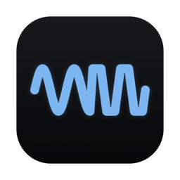

# pibridge



> **Superseded by [PiBridge 2](https://github.com/snakepup2000-hue/pibridge2).** This
> is the original: it works, it is installed as `PiBridge.app`, and it stays as the
> fallback if PiBridge 2 misbehaves. Both can be installed at once
> (`local.pibridge.app` / `local.pibridge2.app`); only one can hold the DAC at a time.
> New work happens in PiBridge 2.

Real-time PCM and **native DSD256** streaming from this Mac to a DAC on a Raspberry Pi,
over the SSH path the Pi appliance already speaks. Developed against a FiiO K11 R2R; see
[Setting up your Pi](#setting-up-your-pi) to point it at yours.

No daemon, no cross-compiler, no packages on the Pi. The Mac does the DSP; the Pi runs
either stock `aplay` or the included `receiver/hqdac`, a static binary that drives
`/dev/snd` directly (see **[receiver/README.md](receiver/README.md)**).

`receiver/hqdac.c` and the checked-in `hqdac-aarch64` are byte-identical to PiBridge 2's.
The receiver is shared between the two: it is the same program on the Pi whichever GUI
drives it, and it is rebuilt with `receiver/build-static.sh` (Docker, no cross-compiler).

```bash
./build.sh
./build/pibridge diag                            # is the Pi up, what can the DAC do
./build/pibridge play track.flac                 # PCM 352.8 kHz to the K11
./build/pibridge play track.flac --mode dsd      # native DSD256
./build/pibridge play track.flac --buffer-ms 15  # low latency
./build/pibridge play ~/Music/Album              # a whole folder, in order
./build/pibridge play ~/Music/Album --recursive   # folder and sub-folders
./build/pibridge play track.flac --receiver='~/hqdac' --buffer-ms 4  # fixed, verifiable buffer
```

The PiBridge app has a **Receiver** setting for the same thing (default `~/hqdac`, buffer
8 ms). `pibridge diag` reports whether the receiver is installed and which formats the DAC
confirms.

A folder is played as **one continuous stream**: the DAC rate and the SSH link stay up
across tracks, so nothing is renegotiated between songs. Tracks are ordered naturally
(`02` before `10`), and mixed sample rates are handled per track — the resampler is
rebuilt from the new rate while the output rate stays fixed at the DAC's.

Accepted input is anything CoreAudio decodes (MP3, AAC, ALAC, AIFF, FLAC, WAV); non-WAV
input is transcoded to float32 WAV with `afconvert` first, WAV goes straight in.

## The app

`PiBridge.app` is a SwiftUI front end; the engine above is embedded in the bundle and
runs as a child process, so a UI hang cannot disturb audio.

```bash
./build_app.sh
open build/PiBridge.app
./tools/make_icon.sh          # regenerate the app icon (blue accent)
open -a build/PiBridge.app track.flac     # or drag onto the window / use Open With
```

The queue panel lists the folder in play order with the current track highlighted;
⌘← and ⌘→ skip. It shows the DAC's buffer depth, peak and RMS of what is being sent, the drift trim, and a
live underrun count; **Link test** runs the `diag` command and prints what the Pi and the
K11 actually report. Buffer, gain, PCM/DSD and the network settings persist between runs.

The app build needs Xcode's toolchain, not just CommandLineTools: the CLT SDK does not ship
the `SwiftUIMacros` plugin, so `@State`/`@StateObject` cannot expand there.

## Verified on the actual hardware

Measured against the Pi, not estimated:

| Claim | Result |
|---|---|
| Transport integrity | **bit-exact**: 363 MB of PCM through `ssh` and back to `sha256sum` matched the local render |
| PCM streaming, 15 ms ALSA buffer | 32.8 s, **0 underruns**, buffer fill mean 18.0 ms (sd 4.7, min 1.6, max 23.0) |
| PCM streaming, 200 ms buffer | **0 underruns**, fill mean 196.6 ms |
| Native DSD256, 30 ms buffer | 32.8 s, **0 underruns**, fill mean 26.6 ms |
| DSD512 | **not possible** — K11 reports max 384 kHz word rate; `aplay` falls back to 384 kHz |
| Resampler quality (44.1 → 352.8 kHz, 997 Hz tone) | **THD+N −128.4 dB** at 192 taps |
| DSD256 modulator quality | **in-band THD+N −120.1 dB**, shaped noise −148 dBFS (20 Hz–1 kHz) rising to −138 dBFS (10–20 kHz) |

Reference points measured earlier in the session, for contrast: the same resampler at 96
taps and β=8 gave −105.9 dB; the 384 kHz PCM playback test on the Pi showed the K11
accepting `S16_LE`, `S24_3LE`, `S32_LE` and `DSD_U32_BE` with `DOP=0, bitrev=0`.

## What the hardware actually is

Probed, not assumed:

- Raspberry Pi 4B, 8 GB, **gigabit eth0**.
- Signalyst NAA OS: BusyBox userland, kernel 6.6.63-v8, **no compiler, no python**.
  Anything requiring a build on the Pi is off the table — this is why there is no receiver here.
- FiiO K11 R2R on card 0, ALSA buffer floor 16 frames (41 µs), and `/proc/asound`
  readable while streaming.

## How it works

```
Mac: decode -> windowed-sinc ASRC -> [S32_LE | 1-bit SDM/DSD_U32_BE]
         -> ssh -S <control socket> -> aplay -> K11 R2R
                                     ^
         ALSA buffer depth polled over a second channel on the same connection
```

One `ssh -M` master connection is opened once; the audio stream and the telemetry poller
are channels under it, so polling costs nothing per poll.

`src/asrc.hpp` is a single arbitrary-rate windowed-sinc converter (Kaiser β=10.5, 192 taps,
512 phases, unity DC gain) that serves two purposes: resampling to the DAC rate, and a
±500 ppm ratio trim used for drift correction. The trim is a rate change, not a block
splice, so it cannot click.

`src/dsd.hpp` is the 4th-order 1-bit modulator from `SignalPath/Sources/SignalPathCore/DsdModulator.swift`,
packed MSB-first per 32-bit word for `DSD_U32_BE`.

## Measurement defects found after first listening

Two faults made the tool under-report real problems:

- **`aplay`'s stderr was read only after playback ended**, and the counter was
  incremented at most once. A click in the first second of a 30 s track showed as
  `underruns 0`. It is now streamed live on a thread and counted per occurrence.
- **The write block defaulted to 20 ms, the same size as the default buffer.** Every
  write then waited for a full drain. Blocks now default to `min(10 ms, buffer/4)`.

Measured before the fix: 229 s at a 20 ms buffer drained from 23.7 ms to 13.7 ms of
fill — **−128 ms/hour** — reaching 1.49 ms minimum, i.e. one poll away from an
underrun that the old counter would not have shown.

Closed-loop drift correction exists (`--steer`) but is **off by default**: under
`aplay` the ALSA buffer saturates while `aplay`'s own stdin buffer absorbs the rest,
so the loop has poor authority, and an oscillating resample ratio is audible warble.
It is not trusted until it can be shown to settle.

## Two pacing modes

`--pace backpressure` (default) writes as fast as the socket accepts. `aplay` keeps its
ALSA buffer full by design and the pushback paces the stream; the DAC's clock decides the
tempo. Measured drift at 15 ms: none in 130 s.

`--pace clock` writes to a timeline. This is the mode that would let you hold a fixed small
buffer, and it is **not** proven: because `aplay` insists on filling the buffer before it
starts, a locally-clocked writer fights it, and in an early test the fill sat at 179 ms of
a 200 ms buffer while the trim railed at −500 ppm. The controller is still in the binary,
now steering on the reported fill depth only, but it is experimental and off by default.

The honest summary: **`aplay` is the floor**, unless you stop using it. In-flight latency
under aplay settles at about one buffer depth plus whatever ssh holds, and the settlement
point is not fully under the Mac's control.

That was fixed. `receiver/hqdac` is the protocol peer this paragraph used to say was
missing: a static aarch64 binary that issues the PCM ioctls itself, so the device buffer is
set by us and polled back with `DELAY`. Measured on the K11 at a 4 ms device buffer plus a
2 ms ring — the smallest the hardware holds — a full 7-minute track ran with **0 underruns**,
mean fill **4.2 ms, sd 0.23 ms**, and no drift across 185 s of sampling. Select it with
`--receiver=~/hqdac`, or in the app's Receiver setting.

With a custom receiver pibridge switches to `--pace backpressure` by itself: the clock
pacer was written against aplay, and against hqdac it left a 20 ms request at 5 ms of fill
instead of 20.08 ms.

## Limits

- Pi must be reachable and your SSH key already in its `~/.ssh/authorized_keys`.
- One concurrent player; a second `aplay` gets "device busy", which is the K11 being single-tenant.
- Mono input is duplicated to both channels; anything above stereo is rejected.
- DSD is capped at DSD256 because of the K11's 384 kHz word rate.
- No seek and no pause; skip works (`next`/`prev` on the control channel).
- A track boundary is gapless when the next track has the same sample rate. A rate
  change rebuilds the converter, which leaves a gap of one kernel length.
- Folder scanning is one level deep unless `--recursive` is given.
- The receiver accepts `hw:` devices only: it has no plug/conversion layer, so a format the
  DAC does not accept is an error rather than a silent conversion.

## Requirements

macOS 13 or later / Apple silicon. A Raspberry Pi reachable over SSH with a DAC that
`aplay` can open. Nothing is installed on the Pi beyond what the image already has.

Built and tested against a Raspberry Pi 4B running the Signalyst NAA image (no sudo,
pubkey-only SSH) and a FiiO K11 R2R, which is what the latency and underrun numbers
below were measured on.

## Setting up your Pi

Nothing here assumes anything about your network. The defaults are a Raspberry Pi
answering to its mDNS name, the standard `pi` account, `~/.ssh/id_ed25519`, and ALSA
device `hw:0,0`. What has to be true:

**1. The Pi answers, and you can log in.**

```bash
ssh pi@raspberrypi.local
```

No mDNS name? Use the address. Raspberry Pi OS ships Avahi; minimal images
(Signalyst's NAA, for instance) often do not advertise one.

**2. Key-based, non-interactive SSH** — the engine runs `ssh` in batch mode, so a
password prompt is a hang.

```bash
ssh-keygen -t ed25519 -C pibridge     # if you have no key yet
ssh-copy-id pi@raspberrypi.local
ssh -o BatchMode=yes pi@raspberrypi.local true && echo works
```

**3. `aplay` sees the DAC.**

```bash
ssh pi@raspberrypi.local 'aplay -l; cat /proc/asound/cards'
```

The device is `hw:N,0`, N from that output — `hw:0,0` for the usual single USB DAC.
It must be the `hw:` form: the stream is written raw, and there is no conversion
layer to absorb a format the device will not take.

**4. Point pibridge at it.** `pibridge diag` prints what it is about to use and then
reports the Pi's OS, its sound cards, the formats and rates the DAC accepts, whether
the receiver is installed, and the link speed. Fix anything it flags before trying
to play.

Values come from, in order: the flag, the environment variable, the default.

| flag | environment variable | default |
|---|---|---|
| `--host` | `PIBRIDGE_HOST` | `raspberrypi.local` |
| `--user` | `PIBRIDGE_USER` | `pi` |
| `--device` | `PIBRIDGE_DEVICE` | `hw:0,0` |
| `--key` | `PIBRIDGE_KEY` | `~/.ssh/id_ed25519` |

```bash
pibridge diag --host 192.168.1.50 --user pi --device hw:0,0
PIBRIDGE_HOST=192.168.1.50 pibridge diag      # same thing
```

The app has the same defaults and reads the same variables, so launching it from a
shell with `PIBRIDGE_HOST` set configures it without touching the UI.

One master per `user@host`: the control socket is
`/tmp/pibridge-<user>@<host>.sock`, not one shared path. `ssh -O check` only
proves that *a* master is alive on the socket, not that it points at the host you
asked for, so a shared socket silently reuses a connection to a different machine.
Pass `--sock` to override.


## Licence

MIT. See `LICENSE`.

## Files

```
src/asrc.hpp       windowed-sinc ASRC with live ratio trim
src/dsd.hpp        4th-order 1-bit modulator
src/wav.hpp        streaming WAV reader (PCM 16/24/32, float 32/64)
src/link.hpp       ssh ControlMaster + channel plumbing
src/defaults.hpp   host / user / device / key defaults, in one place
src/main.cpp       CLI (play/diag), prefill, pacing, telemetry, metrics
build.sh           builds with the CommandLineTools toolchain (see note below)
```

`build.sh` pins `/Library/Developer/CommandLineTools` because this machine's default
toolchain pairs an older `ld` with a newer SDK (`arm64e.x1-macos` unknown architecture).
That mismatch is a machine-level issue, not a project one.
